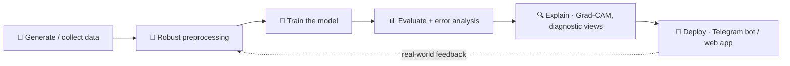

<!-- ===================== HEADER ===================== -->
<div align="center">


<br/>


</div>

<br/>

## 👋 About me

I'm a **Computer Engineering student** building machine learning systems and testing them where it counts: on real data, not just on a clean test split.

> **Does the model still work when it leaves the notebook?**

That question drives how I work. I generate my own data, build preprocessing that survives messy phone photos, evaluate honestly (including where the model fails), explain predictions with tools like Grad-CAM, and ship the result so anyone can try it.

```
data generation  →  training  →  evaluation  →  explanation  →  deployment
```

<br/>

## 📊 By the numbers

<div align="center">
<table>
<tr>
<td align="center" width="25%"><h3>12,000</h3>synthetic training images generated by code, <b>zero hand-labelled</b></td>
<td align="center" width="25%"><h3>99.8%</h3>test accuracy of the shape classifier on 2,400 held-out images</td>
<td align="center" width="25%"><h3>~99%</h3>MNIST test accuracy, tested end-to-end on real phone photos</td>
<td align="center" width="25%"><h3>99%</h3>goal-reach rate of a Q-learning agent on a 15×15 maze</td>
</tr>
</table>
</div>

<sub>Details and honest caveats (for example, synthetic vs. real-photo performance) are in each project's README.</sub>

<br/>

## 🧭 How my projects work



<br/>

## 🚀 Featured projects

### 👁️ Computer Vision & Explainable AI

<table>
<tr>
<td width="50%" valign="top">

#### 🔷 [Shape Classifier XAI](https://github.com/parsakhattat/shape-classifier-XAI)
A CNN trained **only on code-generated drawings** that recognises hand-drawn shapes (circle, square, triangle, star) in ordinary phone photos.

- **99.83%** accuracy on 2,400 held-out synthetic images; only 4 errors
- Preprocessing built to close the sim-to-real gap: illumination flattening, adaptive threshold, merging of broken strokes
- Test-time augmentation (8 passes) and an **UNKNOWN** answer below 85% confidence
- Three-panel diagnostic view: original photo, exact network input, per-class confidence
- Telegram bot, MIT license, documented limitations

`TensorFlow` `Keras` `OpenCV` `Telegram Bot`

</td>
<td width="50%" valign="top">

#### 🔷 [Handwritten Digit Recognition + Grad-CAM](https://github.com/parsakhattat/handwritten-recognition-XAI)
A CNN trained on MNIST with **Grad-CAM** heatmaps, built so a photo of a digit you wrote on paper gets a prediction and an explanation.

- **~99%** test accuracy with augmentation tailored to real photos (rotation, shift, zoom, shear)
- Polarity detection, Otsu thresholding and center-of-mass alignment so phone photos match MNIST statistics
- Telegram bot with `/explain` (heatmap) and `/compare` (all models side by side)
- Debug image shows exactly what the model received

`TensorFlow` `Keras` `Grad-CAM` `Telegram Bot`

</td>
</tr>
</table>

### 🎮 Reinforcement Learning

<table>
<tr>
<td width="50%" valign="top">

#### 🔷 [Maze Navigation · Q-Learning](https://github.com/parsakhattat/Reinforcement-Learning-for-Autonomous-Maze-Navigation-A-Q-Learning-Approach)
A Q-learning agent that learns to cross randomly generated mazes of **5×5, 10×10 and 15×15**, avoiding traps and collecting bonuses.

- Mazes built with recursive backtracking (always solvable); traps and bonuses placed off the BFS shortest path
- Epsilon-greedy exploration, reward shaping, hyperparameters adapted to maze size
- **99.15%** goal-reach rate on a 15×15 maze, ~36 steps per episode
- Real-time Pygame visualization plus fast training mode; pre-trained Q-tables included

`Python` `NumPy` `Pygame`

</td>
<td width="50%" valign="top">

#### 🚧 [RL TicTacToe · Hand Gesture Control](https://github.com/parsakhattat/Reinforcement-Learning-TicTacToe-with-Hand-Gesture-Control)
**In progress.** An RL agent you play against using hand gestures captured by a webcam. The repository is being built step by step; the first working demo will be added here.

`Reinforcement Learning` `Computer Vision`

</td>
</tr>
</table>

### 💬 NLP & Applications

<table>
<tr>
<td width="50%" valign="top">

#### 🔷 [Cinema Sentiment Analyzer](https://github.com/parsakhattat/Cinema-Sentiment-Analyzer)
A Streamlit app that classifies movie reviews as positive or negative and shows a confidence score.

- NLTK preprocessing with **negation handling** ("not good" → `not_good`) and TF-IDF features
- Logistic regression, **0.89** validation accuracy, tuned decision threshold
- Written error analysis (sarcasm, rare words, threshold sensitivity)
- Prediction history log and input validation

`scikit-learn` `NLTK` `Streamlit`

</td>
<td width="50%" valign="top">

#### 🔷 [IELTS Dictation App](https://github.com/parsakhattat/IELTS-dictation-app)
A deployed Flask web app for IELTS spelling practice. **[Try the live demo →](https://ielts-dictation-app.onrender.com/)**

- Word categories stored in plain `.txt` files, easy to extend
- Speech synthesis (Web Speech API), instant feedback, hints and scoring
- Live on Render, MIT licensed

`Flask` `JavaScript` `Web Speech API`

</td>
</tr>
</table>

<br/>

## 🧪 How I work

| | Principle | In practice |
|---|---|---|
| 🌍 | **Test on reality** | Phone photos and a Telegram bot, not just a held-out split |
| 🔁 | **Reproducible** | Seeded, stratified splits, shared model definition, cached datasets, one-command evaluation |
| 🔬 | **Diagnosable** | Debug views of the exact model input, confusion matrices, misclassification breakdowns |
| 📝 | **Honest** | Every project documents its limitations and failure cases |
| 🔐 | **Safe by default** | Bot tokens read from environment variables, never committed |

<br/>

## 🛠️ Tech stack

<div align="center">


</div>

<!-- PyTorch badge intentionally removed: none of the current repos use it. Add it back once a PyTorch project is public. -->

<br/>

## 🌱 What I'm working on next

- [ ] **Grad-CAM for the shape classifier**, so its explainability matches its name
- [ ] **Deep Q-Network (DQN)** and learning-curve plots for the maze agent
- [ ] **Transformer (BERT) vs. TF-IDF** comparison for the sentiment analyzer, plus a public deployment
- [ ] **Finish the gesture-controlled TicTacToe** with an RL agent and a live demo

<br/>

## 📈 GitHub activity

<div align="center">


</div>

<br/>

## 📫 Let's connect

<div align="center">

<a href="https://t.me/Parsa_xtt"></a>
<!-- Add when ready (uncomment and fill in): -->
<!-- <a href="https://www.linkedin.com/in/YOUR-ID"></a> -->
<!-- <a href="mailto:YOUR@EMAIL"></a> -->

<br/><br/>

<i>"I care more about models that work on real photos than models that get 99.9% on a clean test set."</i>

<br/>


</div>
